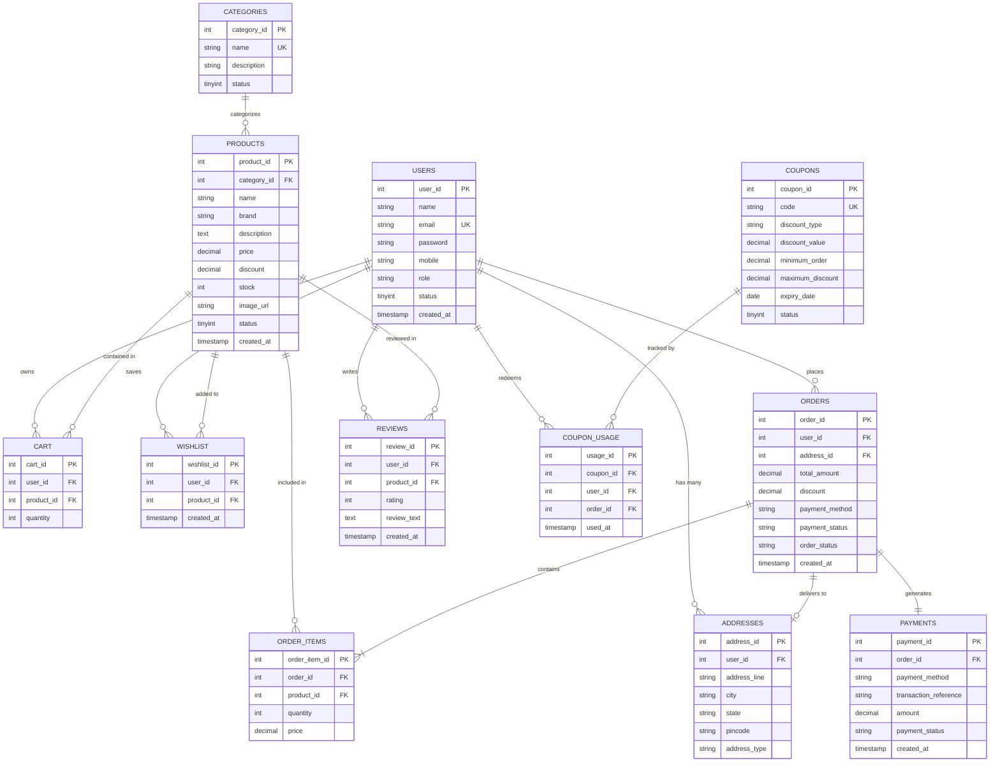

# ShopSphere — Database Design & Entity Relationship

## 1. Entity-Relationship (ER) Diagram

---

## 2. Table Data Dictionary

### `users`
- Stores registered customer and staff administrator accounts.
- `password`: Stored as a 64-character SHA-256 cryptographic hash (never plaintext).
- `role`: Restricted to `'CUSTOMER'` or `'ADMIN'`.

### `products`
- Catalogs physical inventory with current pricing, discount percentage, and warehouse stock.
- `stock`: Checked prior to order confirmation and deducted atomically within the checkout transaction.

### `orders` & `order_items`
- Maintains immutable historical records of placed customer orders.
- Stores historical purchase price per unit inside `order_items` so that future product price modifications do not alter completed order statements.
