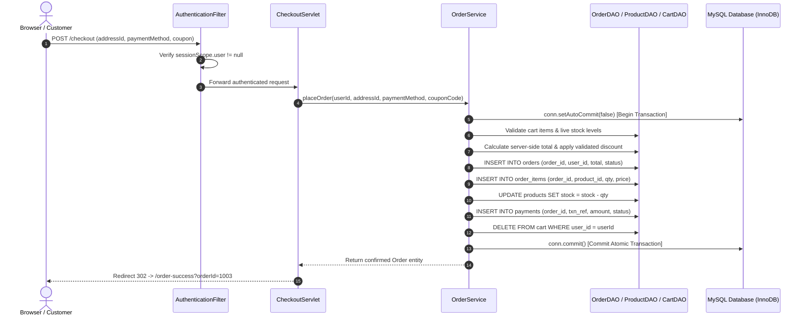

# ShopSphere — System Architecture Documentation

## 1. High-Level Enterprise Architecture

ShopSphere is built upon an enterprise N-Tier architectural pattern aligning with the RTU Advanced Java specification. It cleanly decouples presentation, controller dispatch, business rules, data access, and persistent storage.

```mermaid
graph TD
    subgraph Client Tier
        Browser["Modern Web Browser (HTML5 / Bootstrap 5 / JS)"]
        SwingApp["Desktop Admin GUI (Java Swing MVC)"]
        SocketClient["Socket Inventory Client (java.net)"]
        RmiClient["RMI Remote Client (java.rmi)"]
    end

    subgraph Container Tier (Apache Tomcat 11)
        Filter["Filters (AuthenticationFilter, AdminFilter)"]
        Listener["Listeners (AppListener - Context & Session)"]
        ServletController["Servlet Controllers (Jakarta Servlet 6.1)"]
        JspViews["JSP Views + EL + JSTL 3.0 + Custom Tags"]
    end

    subgraph Business Logic Tier
        AuthService["AuthenticationService (PBKDF2/SHA-256)"]
        ProductService["ProductService"]
        CartService["CartService"]
        OrderService["OrderService (Transactional Checkout)"]
        CouponService["CouponService"]
        RmiServer["RMI Remote Service (UnicastRemoteObject)"]
        SocketServer["TCP Inventory Server (ServerSocket:8089)"]
    end

    subgraph Data Access Layer (DAO)
        UserDAO["UserDAO"]
        ProductDAO["ProductDAO"]
        CategoryDAO["CategoryDAO"]
        CartDAO["CartDAO"]
        OrderDAO["OrderDAO"]
        ReviewDAO["ReviewDAO"]
        CouponDAO["CouponDAO"]
    end

    subgraph Storage Tier
        MySQL[(MySQL 8.x / 9.x Database 'shopsphere')]
    end

    Browser -->|HTTP/HTTPS| Filter
    Filter --> ServletController
    ServletController --> JspViews
    ServletController --> AuthService & ProductService & CartService & OrderService & CouponService
    
    SwingApp -->|JDBC| UserDAO & ProductDAO & CategoryDAO & OrderDAO
    SocketClient -->|TCP Socket Streams| SocketServer
    RmiClient -->|RMI / JRMP 1099| RmiServer

    AuthService --> UserDAO
    ProductService --> ProductDAO & CategoryDAO
    CartService --> CartDAO & ProductDAO
    OrderService --> OrderDAO & CartDAO & ProductDAO & CouponDAO
    CouponService --> CouponDAO

    SocketServer --> ProductDAO
    RmiServer --> ProductDAO

    UserDAO & ProductDAO & CategoryDAO & CartDAO & OrderDAO & ReviewDAO & CouponDAO -->|JDBC PreparedStatement| MySQL
```

---

## 2. N-Tier Web Request-Response Cycle



---

## 3. Desktop Swing Administration (MVC Pattern)

- **Model:** Independent serializable entities (`Product`, `Category`, `User`, `Order`).
- **View:** `LoginFrame` and `AdminDashboard` using `JTabbedPane`, `JTable`, `JScrollPane`, `JOptionPane`.
- **Controller/DAO:** `AdminDAO` executing transactional PreparedStatement JDBC operations directly against MySQL.
